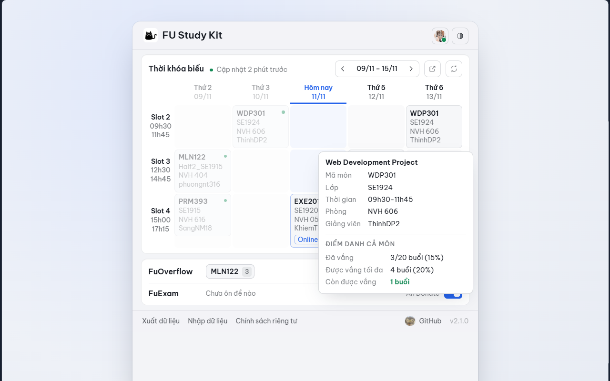
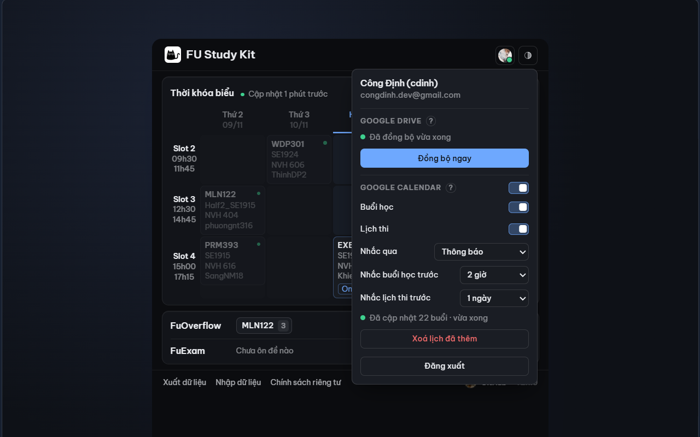
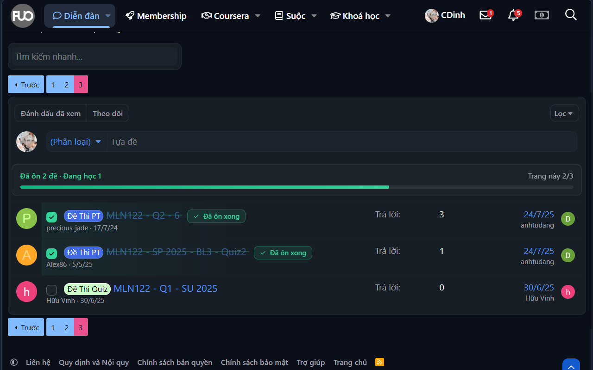
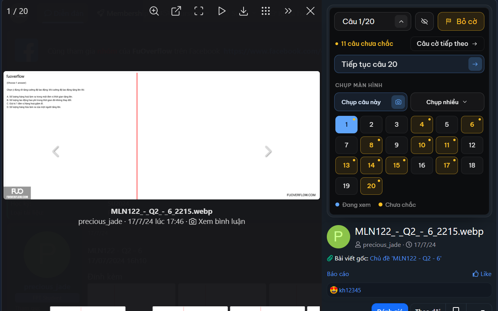

# FU Study Kit

**Revise smarter, and never miss a class or an exam.**

[**Download v2.1.0**](https://github.com/CDinhh/Extension-FU-Study-Kit/releases/latest) ·
[Home page](https://cdinhh.github.io/Extension-FU-Study-Kit/) ·
[Privacy](https://cdinhh.github.io/Extension-FU-Study-Kit/privacy.html) ·
[Report a bug](https://github.com/CDinhh/Extension-FU-Study-Kit/issues) ·
[Tiếng Việt](README.md)

| FAP timetable and attendance | Google account: Drive and Calendar |
|---|---|
|  |  |
| **Revision checklist on FuOverflow / FuExam** | **Jump, flag, capture with discussion** |
|  |  |

The extension's interface is in Vietnamese.

## Features

- **FAP timetable** right in the popup: every week of the term, exams highlighted, last update always shown.
- **Attendance**: hover a class to see your absences and how many you can still miss before the 20% limit.
- **Revision checklist** on FuOverflow and FuExam, plus the exams you are studying and the question you reached.
- **Image viewer**: jump to any question, flag the unsure ones, cover the answer, and capture every question with its discussion as a ZIP.
- **Studied subjects** in the popup, one click to open an exam or a subject.
- **Google Drive** (optional): progress, timetable and attendance follow you to another computer.
- **Google Calendar** (optional): classes and exams in a separate calendar that follows FAP, never duplicated, with notification or email reminders.
- Light / dark theme, JSON export and import.

## Install

Download the ZIP from the [latest release](https://github.com/CDinhh/Extension-FU-Study-Kit/releases/latest) and unzip it. Open `chrome://extensions`, turn on **Developer mode**, click **Load unpacked** and choose the unzipped folder. Works in Chrome, Edge, Brave and other Chromium browsers.

## Privacy

No server of its own, no analytics, no ads. Your data stays in your browser. If you sign in with Google, the extension only writes one file to its own hidden folder in your Drive (`drive.appdata`) and, if you turn it on, manages one calendar it creates (`calendar.app.created`). See the [privacy policy](https://cdinhh.github.io/Extension-FU-Study-Kit/privacy.html).

Not an official FuOverflow, FuExam or FPT University product.

## Development

No build step and no dependencies. Run the tests with `node --test`. To build with your own Google account: enable the Google Drive API and Google Calendar API in a Google Cloud project, create an OAuth client of type **Web application** with the redirect URI `https://<extension-id>.chromiumapp.org/`, and put its client ID in `DRIVE_CLIENT_ID` in `drive.js`.

The website uses [Be Vietnam Pro](https://github.com/bettergui/BeVietnamPro) (OFL) and [Font Awesome Free](https://fontawesome.com) icons.
