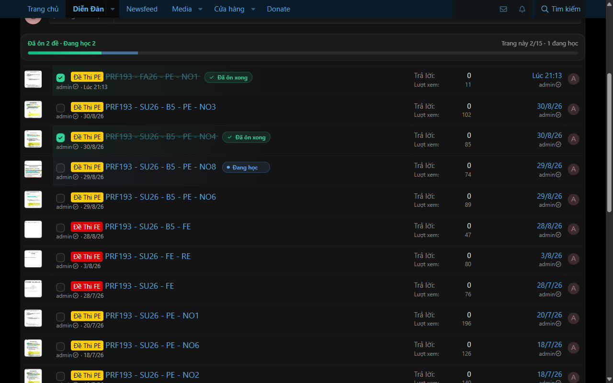
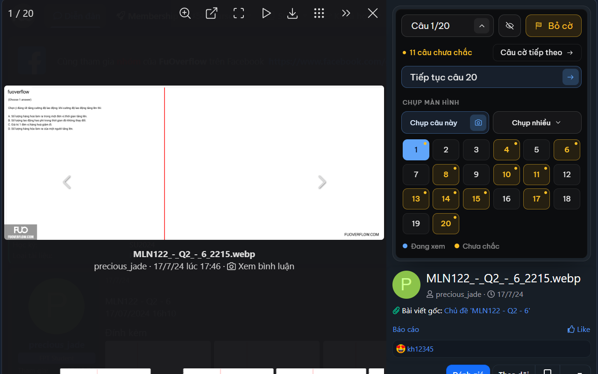

# FU Study Kit: Exam Checklist & FAP Timetable

**Tiếng Việt** · [English](README.en.md)

Extension trình duyệt (Manifest V3) cho sinh viên FPT: theo dõi việc ôn đề trên hai diễn đàn
[FuOverflow](https://fuoverflow.com) và [FuExam](https://fuexam.me), và xem lịch học FAP ngay trong popup.

- Đánh dấu đề đã ôn, đề đang học và câu đang làm dở, ngay trên danh sách thread.
- Nhảy nhanh tới câu bất kỳ khi xem ảnh đề, gắn cờ câu chưa chắc, che đáp án để tự kiểm tra.
- **Chụp tự động toàn bộ câu hỏi kèm khung chat thảo luận đáp án**, nén sẵn thành file ZIP.
- **Thời khóa biểu tuần, lịch thi và báo cáo điểm danh của FAP** ngay trong popup (tuỳ chọn).
- **Đồng bộ qua Google Drive** sang máy khác, và **đưa lịch học vào Google Calendar** (tuỳ chọn).

> Không phải extension chính thức của FuOverflow / FuExam / Đại học FPT.

## Tính năng

### Checklist đề đã ôn

- Checkbox trước tiêu đề mỗi thread trong danh sách (và ở tiêu đề trang chi tiết đề).
- Thread đã tick bị gạch ngang và có nhãn **"Đã ôn xong"**.
- Thanh tiến độ cho biết tổng số đề đã ôn / đang học và số đề trên trang hiện tại.

### Đề đang học và tiến độ câu

- Bấm vào một đề (hoặc mở trang đề) là đề đó được đánh dấu **"Đang học"**.
- Xem tới câu nào trong lightbox thì danh sách hiện **"Đang học tới câu 8/60"**.
- Mở lại đề từ câu 1, panel có nút **"Tiếp tục câu X"** để quay về chỗ đang học.
- Rê chuột vào nhãn "Đang học" sẽ hiện nút `×` để xoá trạng thái nếu bấm nhầm.

### Nhảy câu, gắn cờ và chụp màn hình trong lightbox

Khi mở ảnh đề, cột bên phải có panel điều khiển:

- **"Câu x/N"**: mở bảng số để nhảy thẳng tới câu bất kỳ.
- **Che đáp án** (nút con mắt gạch): thêm vùng che kính mờ nổi trên ảnh đề. Kéo để di chuyển, kéo góc
  để đổi cỡ, giữ nút con mắt để xem nhanh, `×` để bỏ. Vùng che được nhớ theo từng đề trên máy này, giữ
  nguyên khi chuyển câu và tự ẩn khi chụp màn hình.
- **"Gắn cờ"**: đánh dấu câu đang xem là chưa chắc. Khi đã có cờ sẽ hiện thêm **"Câu cờ tiếp theo"**.
- **Chụp câu này**: chụp câu đang xem kèm khung chat, tải về 1 file PNG.
- **Chụp nhiều**: chọn **Câu** (tất cả hoặc chỉ câu có cờ), **Nội dung** (kèm đáp án hoặc chỉ đề) và
  **Tốc độ** mỗi câu (0,5–1,5 giây để ảnh và bình luận kịp tải), rồi bấm **Bắt đầu chụp**. Kết quả nén
  thành ZIP, ví dụ `fuexam-<id>-kem-chat-tat-ca.zip`. Có nút **Dừng**, tự tạm dừng khi bạn chuyển tab.

**Lần đầu chụp**, trình duyệt cần quyền chụp tab: bấm icon extension trên thanh công cụ → **"Cho phép"**.
Extension chỉ chụp khi bạn bấm nút chụp.

### Thời khóa biểu, lịch thi và điểm danh FAP

- Mặc định tắt. Bấm **Bật thời khóa biểu** trong popup, trình duyệt sẽ xin quyền truy cập `fap.fpt.edu.vn`.
- Extension mở trang WeeklyTimetable trong một tab nền bằng phiên đăng nhập sẵn có của bạn, đọc lịch của
  mọi tuần (cả tuần cũ lẫn tuần sau), rồi đọc trang Báo cáo điểm danh của từng môn trong kỳ. Đọc xong
  tab tự đóng. Hết phiên FAP thì tab hiện lên để bạn đăng nhập (cách nào cũng được), xong tự cập nhật.
- Lịch hiện dạng bảng. Nút `‹` `›` để chuyển tuần, bấm vào ngày tháng để về tuần này. **Lịch thi** được
  tô màu riêng.
- Dòng trạng thái luôn ghi lần cập nhật gần nhất. Mở popup mà lịch đã cũ hơn 1 giờ thì lịch tự làm mới;
  nút làm mới để cập nhật ngay, nút ↗ mở trang thời khóa biểu FAP trong tab mới.
- **Điểm danh:** rê chuột (hoặc Tab tới) một ô trong thời khóa biểu để xem mã môn, lớp, thời gian,
  phòng, giảng viên, buổi đó có mặt hay vắng, và điểm danh cả môn: **Đã vắng** (vd. 3/20 buổi, 15%),
  **Được vắng tối đa** (20% số buổi) và **Còn được vắng** bao nhiêu buổi. Ô của môn đã hết lượt vắng có
  viền dưới màu vàng, quá 20% thì viền đỏ.

### Môn đã ôn trong popup

- Mỗi diễn đàn hiện các môn đã ôn, môn ôn gần nhất đứng đầu. Mỗi môn là một chip kèm số đề; từ 7 môn
  trở lên, các môn cũ được gom vào chip `+N`.
- Bấm chip để mở danh sách đề của môn đó, với trạng thái **Đã ôn**, **Câu x/N** hoặc **Đang học** và số
  câu gắn cờ. Bấm tên đề để mở thẳng đề, **Mở môn ↗** để mở trang môn, bấm tên diễn đàn để mở trang chủ.
- Tên đề và tên môn được ghi lại khi bạn mở đề hoặc trang môn. Đề ôn từ trước đó tạm hiện là "Đề #id"
  trong nhóm "Khác" cho tới khi bạn mở lại.
- **Công tắc dọn trang** (mặc định tắt, cạnh tên diễn đàn): "Ẩn Donate" của FuExam (banner nổi dưới đáy
  màn hình) và "Ẩn popup" của FuOverflow (hộp "Tham gia cộng đồng" và popup quảng cáo "Công cụ hỗ trợ học
  tập", được đóng bằng nút đóng của chính trang). Có tác dụng ngay, không cần F5.

### Tài khoản Google: Drive và Calendar (tuỳ chọn)

Bấm nút đám mây ở góc trên popup và đăng nhập Google. Sau đó bấm vào ảnh đại diện để mở menu tài khoản;
mỗi mục có icon **(?)** giải thích chi tiết.

- **Google Drive:** tiến độ ôn đề, tên đề, thời khóa biểu, điểm danh và cài đặt Calendar được lưu vào thư
  mục ẩn riêng của extension trên Drive của bạn (quyền `drive.appdata`, không đọc được file nào khác).
  Tự đồng bộ khi mở popup và vài giây sau mỗi thay đổi; hai máy cùng sửa thì bản mới hơn được giữ. Máy
  chưa đăng nhập FAP vẫn xem được lịch lấy từ Drive. Có nút **Đồng bộ ngay** trong menu.
- **Google Calendar:** bật công tắc **Google Calendar** và cấp quyền. Buổi học và lịch thi được thêm vào
  một lịch riêng tên **"FU Study Kit – Lịch học"** (quyền `calendar.app.created`, extension không đọc hay
  sửa lịch khác của bạn).
  - Lịch FAP đổi thì sự kiện tự sửa theo; buổi bị dời hoặc huỷ thì sự kiện cũ tự xoá. Không tạo trùng.
  - Tuỳ chọn: đưa **Buổi học** và/hoặc **Lịch thi**; **Nhắc qua** thông báo, email hoặc cả hai;
    **Nhắc buổi học trước** và **Nhắc lịch thi trước** (không nhắc, 15 phút … 2 ngày).
  - **Xoá lịch đã thêm** (bấm hai lần để xác nhận) xoá cả lịch riêng đó và tắt đồng bộ Calendar.
- **Đăng xuất** ở cuối menu: thu hồi quyền và xoá thông tin tài khoản trên máy. Dữ liệu trên Drive và lịch
  trên Calendar vẫn còn.

### Xuất / Nhập file

Ở chân popup, dành cho ai không muốn đăng nhập Google:

- **Xuất dữ liệu**: tải về `fu-exam-checklist-YYYY-MM-DD.json` (tiến độ ôn đề của cả hai diễn đàn).
- **Nhập dữ liệu**: chọn file đã xuất ở máy khác. Dữ liệu được **gộp** (bản mới hơn được giữ, không xoá
  gì), có bước xác nhận cho biết bao nhiêu đề được thêm / cập nhật. File sai định dạng bị từ chối.

### Giao diện

- Giao diện sáng / tối theo hệ điều hành; bấm nút tròn ◐ ở góc trên popup để đổi, lựa chọn được nhớ lại.
- Header và footer của popup đứng yên khi cuộn.

## Cài đặt (Brave / Chrome)

1. Mở `brave://extensions` (hoặc `chrome://extensions`).
2. Bật **Developer mode** ở góc trên bên phải.
3. Bấm **Load unpacked** và chọn thư mục này (đã cài rồi thì bấm **Reload** của extension).
4. Mở một trang diễn đàn, ví dụ https://fuoverflow.com/forums/MLN111/ hoặc https://fuexam.me/.

> Sau khi cập nhật extension, bấm **Reload** ở trang extensions rồi **F5** lại tab diễn đàn.
> Nếu quên F5, panel sẽ hiện hộp thoại nhắc tải lại trang.

Nâng cấp từ bản cũ:

- Dữ liệu trong `localStorage` của FuOverflow (bản 1.x) được chuyển sang tự động ở lần mở trang đầu tiên.
- Dữ liệu đã đồng bộ qua Chrome Sync (bản 2.0) được chuyển về máy một lần; extension không dùng Chrome
  Sync nữa.

## Quyền riêng tư

Extension không có máy chủ riêng, không gửi dữ liệu cho tác giả hay bên thứ ba, không analytics, không tải
code từ xa. Dữ liệu nằm trên máy bạn; chỉ khi bạn tự bật, extension mới đọc FAP và lưu vào Google Drive /
Google Calendar của chính bạn. Chi tiết: [chính sách quyền riêng tư](https://cdinhh.github.io/Extension-FU-Study-Kit/vi/privacy.html).

## Phát triển

- Cần Brave/Chrome từ bản 111 (Manifest V3, script lightbox chạy trong `"world": "MAIN"`).
- Không có build step hay dependency.
  - `lib/store-core.js`: logic dữ liệu thuần JS (gộp, kiểm tra file nhập, dữ liệu Drive, sự kiện Calendar).
  - `lib/storage.js`: đọc/ghi `chrome.storage`.
  - `background.js`: đọc FAP; `drive.js` và `calendar.js`: đăng nhập Google, Drive và Calendar (chạy trong
    service worker).
- Chạy test (Node ≥ 18): `node --test`
- **Google sign-in khi tự build:** tạo project trên Google Cloud, bật **Google Drive API** và **Google
  Calendar API**, tạo OAuth client loại **Web application** với redirect URI
  `https://<extension-id>.chromiumapp.org/`, rồi thay `DRIVE_CLIENT_ID` trong `drive.js`. Khi app còn ở
  chế độ Testing, thêm tài khoản của bạn vào **Test users**.
- Đóng gói lên Chrome Web Store: xem [store/listing.md](store/listing.md).
